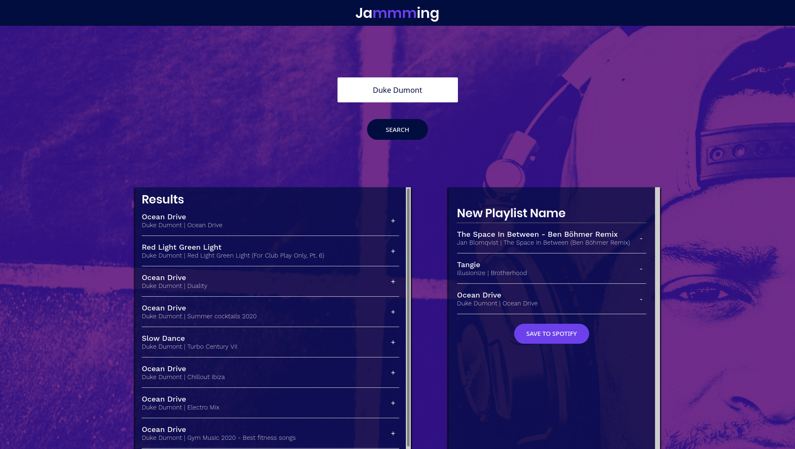
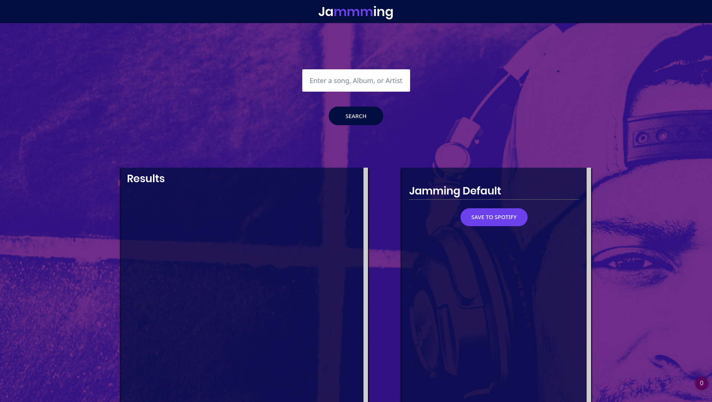

### Deprecated. Sadly the spotify api data isn't available anymore as before and I haven't thought about updating this

# :headphones: [Jamming](http://jamming-luiz6ustav0.surge.sh/) :headphones:

This is a web application where you can search, pick the songs you want, see them in a list and create a new playlist on spotify based on what you choosed.

### :arrow_right: Next steps:
  * Allow user to create a new playlist "randomly" based on his musical interestes
  * Allow users to create playlists based on several different profiles(Friends playlist)
  * Allow users to see their most played artists and songs

### :arrow_right: Screenshots:

